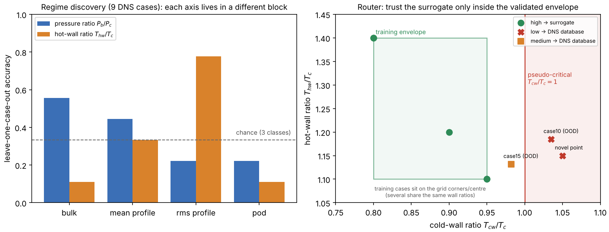
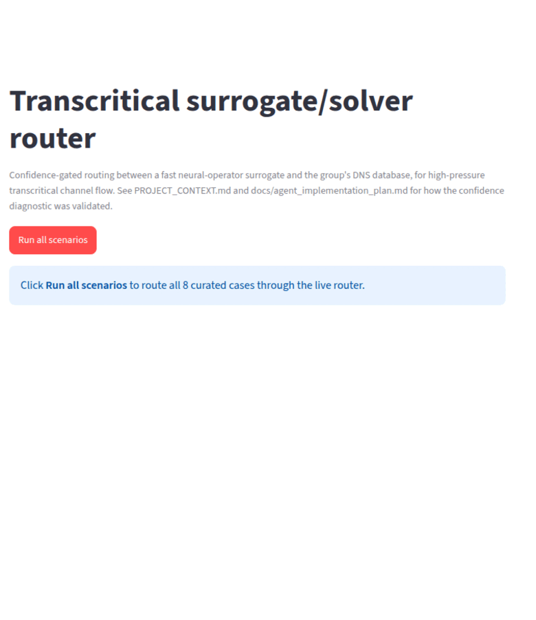

# METIS — ML analysis & discovery for high-pressure transcritical flow

[](https://github.com/gbareas/METIS/actions/workflows/ci.yml)

**M**achine-learning **E**ngine for **T**ranscritical **I**nsight & **S**tatistics:
a tested Python framework that turns direct numerical simulation (DNS)
output of supercritical-CO₂ channel flow into validated features,
reproducible ML experiments and reports.



**Left:** on 9 real DNS cases (a 3×3 grid in pressure ratio and hot-wall
temperature ratio), the two operating parameters are recoverable from
*different* physics features. Bulk dimensionless groups carry the
pressure signal and wall-normal RMS profiles carry the thermal one
(leave-one-case-out accuracy; chance is 1/3). With only 9 cases this is
a small-n result, frozen as the `regime-v1` regression benchmark rather
than claimed as general (see [`FINDINGS.md`](FINDINGS.md) §1-5).
**Right:** the router module only trusts a neural-operator surrogate
inside its training envelope and sends anything past the pseudo-critical
point to the DNS database, the regime where the surrogate was observed
to fail (n=2 out-of-distribution cases, so the policy is deliberately
conservative). Both panels are regenerated by `metis demo`.

## Run it in one command

No DNS data, GPU or API key needed. With Docker:

```bash
git clone https://github.com/gbareas/METIS && cd METIS
docker build -t metis .
docker run --rm -v "$PWD/demo_output:/out" --user "$(id -u):$(id -g)" metis
```

Or with Python ≥ 3.10:

```bash
pip install -e ".[report]"
metis demo            # writes demo_output/
```

The demo runs in a few seconds and does three things:

1. **Pipeline on a synthetic case.** Generates a small DNS-shaped HDF5
   file (random fields, not physics) and runs ingest → validate → physics
   analysis → report on it, to show the framework end to end.
2. **The frozen `regime-v1` benchmark on real-derived data.** Re-runs it
   from a committed 60 KB feature sample extracted from the 11 real DNS
   cases, and checks all 7 frozen checks pass (exit code 1 if not).
3. **The router's confidence policy.** Scores 8 curated operating points
   and shows where each would be routed. Only the decision runs here: the
   surrogate checkpoint and the DNS fields it dispatches to are not in
   this repository.

Outputs: `summary.png`, `regime_v1.json`, `router_decisions.json` and
Markdown reports under `reports/`. CI builds the image and runs the demo
on every push.

## What it is

A reusable analysis and physical-discovery layer that sits **downstream**
of the group's DNS solver, **RHEA** (*Reproducible Hybrid-architecture
flow solver Engineered for Academia*), for high-pressure transcritical
channel flow. RHEA generates the physics and stays upstream and
authoritative; METIS standardises how its output is ingested, validated,
turned into features, analysed, modelled, and reported — so a new study
configures the framework instead of rebuilding the pipeline.

## What it can do

- **Ingest & validate** RHEA snapshots and homogeneous-plane slices into
  `DNSCase` / `SliceCase`; catch bad or incompatible data before analysis
  (`metis.data.{ingestion,registry,validation}`).
- **Standard physics** — bulk dimensionless groups, wall friction
  Reynolds numbers, 1-D wavenumber spectra, snapshot POD — cross-checked
  bit-for-bit against published results (`metis.features`).
- **Regime discovery**, frozen as the reproducible `regime-v1` benchmark
  (`metis benchmark regime-v1`; see `FINDINGS.md`).
- **One analysis API** — `metis analyze physics|spectra|pod|
  regime-features <case>` — each producing a standard, validated,
  saveable result.
- **Cached feature datasets** so re-running an evaluation doesn't re-read
  raw DNS (`metis dataset build`).
- **Reproducible ML** — leakage-safe preprocessing, a small trainer,
  PCA/autoencoder representation models, physics-aware evaluation, MLflow
  experiment tracking, and a reporting layer (`metis report`).
- **`metis` CLI** and an **artifact registry** tying it together.
- A separate **router-agent module** (Track C/D) — OOD-gated routing
  between a neural-operator surrogate and the DNS database, with a
  single-tool LLM explanation layer. See below.

## Install for development

```bash
pip install -e ".[dev]"     # framework + tests; installs the `metis` command
pytest -q                   # ~250 tests, self-contained, a few seconds
```

Optional extras: `ml` (torch, scikit-learn, mlflow), `report`
(matplotlib), `router` + `demo` (the router module), documented in
`pyproject.toml`.

## Running on real DNS data

The DNS data itself is not public. The committed results, the feature
sample and the router's OOD numbers were derived from the research
group's simulations and earlier studies, and are included for research
purposes. With access to it (the standard `raw/` `processed/`
`processed_slices/` layout under one root — point METIS at it with
`--data-root`, `$METIS_DATA_ROOT`, or `data.root` in
`configs/default.yaml`):

```bash
export METIS_DATA_ROOT=/path/to/dns_data
metis cases list
metis case validate case01
metis analyze physics case01
metis benchmark regime-v1
metis report regime-v1 --from results/regime_v1.json
metis report i2b-representation --from results/   # bundles the i2b_*.json study outputs
```

## Router agent (Track C/D)



Routes a transcritical query to a fast neural-operator surrogate **or**
the DNS database based on a *validated* out-of-distribution confidence
signal (blind surrogate error tracks the cold-wall temperature ratio
crossing the pseudo-critical point), and explains the decision in plain
language. The LLM never makes the routing decision. Full write-up,
architecture diagram, and the link to the group's earlier research:
**[`docs/router_agent.md`](docs/router_agent.md)**.

## Where to read more

- **[`docs/`](docs/README.md)** — getting started, architecture, data
  layout, how to add an analysis or a model, reproducibility.
- **`FINDINGS.md`** — the research log: regime discovery (§1-5), and two
  documented negative results where autoencoders did not beat linear
  PCA/POD (§6-7).
